  

   
   

### Hi, I'm Pradeep 👋

I've spent 8+ years making enterprise banking and insurance systems fast and stable, and making their performance **predictable**. My work sits where load testing, observability and machine learning meet. I like questions such as *"what breaks first at 3× traffic, and why?"*, and answering them with evidence rather than guesswork.

- 🔭 **Building:** PerfOracle, a tool that predicts how an application behaves at 3× load from a single load test
- 🎓 **Studying:** MSc Data Science & AI at BITS Pilani
- 🏦 **Domain:** core banking, payments, cards and insurance platforms
- 💬 **Ask me about:** capacity modelling, JVM/GC tuning, APM-driven root cause, and turning test results into go/no-go decisions

 

## ⭐ Featured project

  

**PerfOracle** combines one ordinary load test with the APM, platform, database, JVM and log evidence a team already collects, and turns them into an evidence-backed release decision:

- **Connects** to 20 tool formats (JMeter, LoadRunner, Dynatrace, AppMon, OpenShift, Oracle, PostgreSQL, GC logs and more) and aligns them on one clock
- **Predicts** capacity at 1.5–7× load with a queueing model fitted to the test, and gives calibrated uncertainty bands (bootstrap + split-conformal)
- **Explains** the bottleneck (CPU, connection pool, DB, downstream service or GC) and ranks the experiments that would prove the fix
- **Verifies** every AI-written claim against the evidence; every number traces back to a source file

🔒 The repository stays private while the BAMS Hackathon 2026 is being judged. A demo is available on request.

 

## 🧭 What I do

<table>
<tr>
<td width="33%" valign="top">

#### ⚡ Performance engineering
Workload modelling, load / stress / soak / spike testing, capacity planning, and SLA and go-live readiness for high-volume transaction systems.

</td>
<td width="33%" valign="top">

#### 🔍 Observability & root cause
Tracing bottlenecks across application, JVM, database and infrastructure with APM. GC and heap analysis, SQL tuning, and Kubernetes / OpenShift sizing.

</td>
<td width="33%" valign="top">

#### 🧠 ML for systems
Models that are part statistics, part queueing physics, for capacity prediction. Anomaly detection, forecasting, and AI assistants grounded in verified evidence.

</td>
</tr>
</table>

## 🛠️ Toolbox

**Load & performance testing**      

**Observability & APM**      

**Data, ML & languages**  

**Cloud, platforms & databases**     

 

  <i>"Performance isn't just speed. It's knowing how your system behaves on its worst day, before that day arrives."</i>

