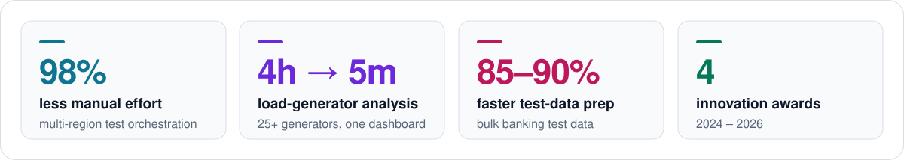
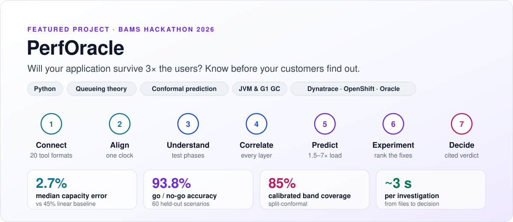
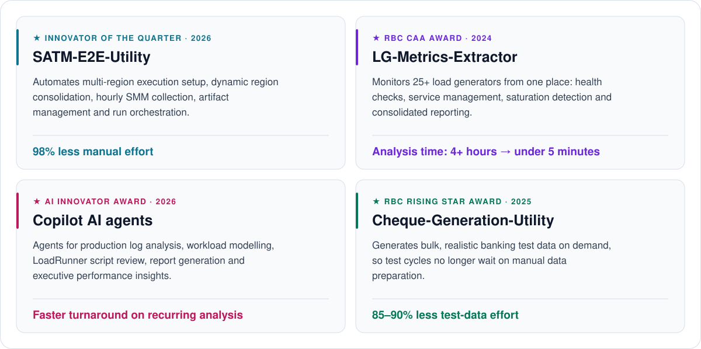
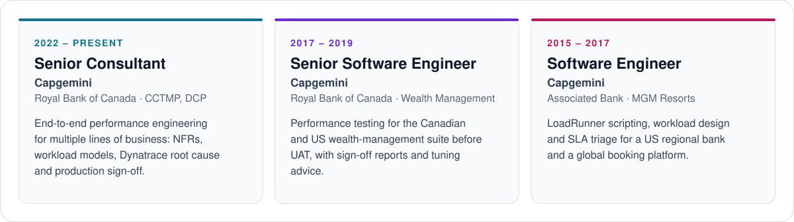
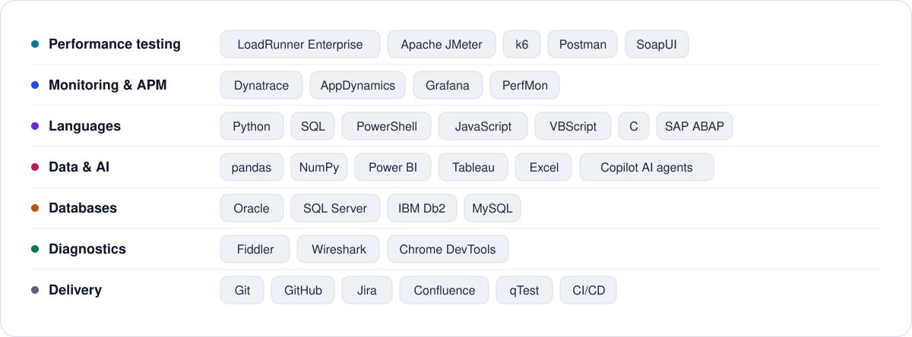

<picture>
  <source media="(prefers-color-scheme: dark)" srcset="assets/header-dark.svg">
  
</picture>

  &nbsp;

I make banking systems behave predictably under load. For more than eight years at **Capgemini** I've owned performance engineering for **Royal Bank of Canada** platforms. That covers the whole path, from NFRs and workload models through LoadRunner Enterprise execution and Dynatrace root-cause analysis to production sign-off. Increasingly I build tools so the analysis no longer depends on manual effort: Python accelerators, Copilot AI agents, and **PerfOracle**, which predicts how an application will behave at 3× load before it ships.

 

### Impact

<picture>
  <source media="(prefers-color-scheme: dark)" srcset="assets/impact-dark.svg">
  
</picture>

 

### Featured project

<picture>
  <source media="(prefers-color-scheme: dark)" srcset="assets/perforacle-dark.svg">
  
</picture>

**PerfOracle** takes one ordinary load test plus the monitoring data a team already has (APM, OpenShift, Oracle and PostgreSQL, JVM GC logs, application logs). It answers the question every release review asks: *will this hold at peak, what breaks first, and which fix should we test next?*

- A queueing model fitted to the test predicts capacity at 1.5–7× load. Bootstrap and split-conformal calibration supply uncertainty bands that are honest about what the model doesn't know.
- Diagnosis covers the full stack: CPU, connection pools, database, downstream services, and G1 garbage-collection pressure correlated with p95 latency.
- Every AI-written sentence is checked against the evidence, and every number can be traced back to its source file.

The repository is private while the BAMS Hackathon 2026 is being judged. A walkthrough is available on request.

 

### Engineering accelerators

<picture>
  <source media="(prefers-color-scheme: dark)" srcset="assets/accelerators-dark.svg">
  
</picture>

Built for client engagements, so the code isn't public.

 

### Experience

<picture>
  <source media="(prefers-color-scheme: dark)" srcset="assets/experience-dark.svg">
  
</picture>

I also mentor performance engineering teams, contribute to Performance CoE initiatives, and lead Gen-AI adoption through agents and shared engineering frameworks.

 

### Toolbox

<picture>
  <source media="(prefers-color-scheme: dark)" srcset="assets/toolbox-dark.svg">
  
</picture>

 

### Credentials

| **MSc Data Science & AI** | BITS Pilani (in progress) |
|---|---|
| **B.Tech, Electronics & Communication** | JNTU Kakinada, 2013 |
| **LoadRunner Professional, Ocean certification** | Practitioner & Master, 2025 |
| **Microsoft Certified: AI Fundamentals** | 2025 |
| **Python certification** | freeCodeCamp, 2026 |

 

Performance work is about knowing how a system behaves on its worst day, before that day arrives.

